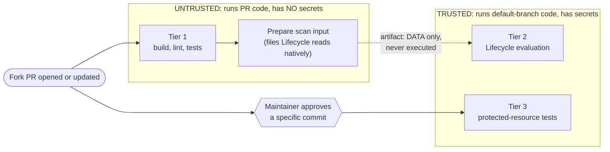
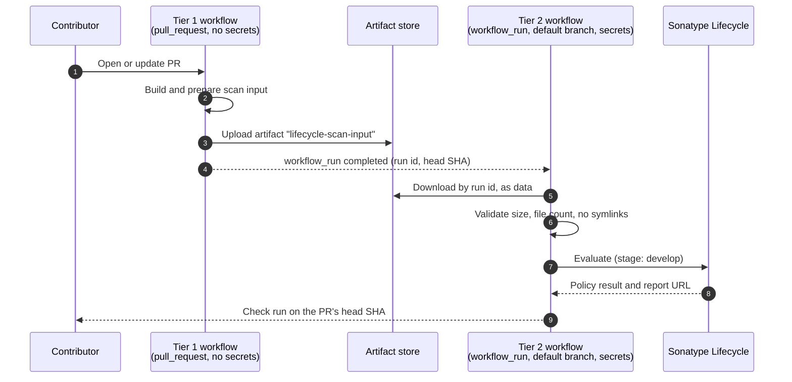

{}
**Status: DRAFT - for community and maintainer review.** This section defines proposed standards and boundaries. It is available for adoption as a draft (see [Adoption and ratification](#adoption-and-ratification)), but nothing here has been run in a real Project yet. The workflow snippets are reference drafts: they have been checked for syntax, but **not yet run end to end in GitHub Actions**.
{}

{}
The use of **must** and **should** indicate whether it is a requirement or a strong guideline.
{}

## Contents

- [The problem](#the-problem)
- [Principles](#principles)
- [Overview of the tiers](#overview-of-the-tiers)
- [Tier 1: Open checks (no secrets)](#tier-1-open-checks-no-secrets)
- [Tier 2: Sonatype Lifecycle evaluation](#tier-2-sonatype-lifecycle-evaluation)
- [Tier 3: Protected-resource integration tests](#tier-3-protected-resource-integration-tests)
- [Trusted refs, releases and tags](#trusted-refs-releases-and-tags)
- [Intermediate branches](#intermediate-branches)
- [Repository and organization settings](#repository-and-organization-settings)
- [Workflow hygiene](#workflow-hygiene)
- [Contributor experience](#contributor-experience)
- [What Projects must, should and must not do](#what-projects-must-should-and-must-not-do)
- [Adoption and ratification](#adoption-and-ratification)
- [Your tool or ecosystem is not covered](#your-tool-or-ecosystem-is-not-covered)
- [Decisions recorded](#decisions-recorded)
- [Open questions for review](#open-questions-for-review)
- [Glossary](#glossary)

In this section:

- [Reference workflows]({}): the complete Tier 1 to Tier 2 workflow pair that every ecosystem guide builds on.
- [Ecosystem guides]({}): what to prepare, and the Tier 1 snippet to prepare it, for each language.

## The problem

Our Projects run two kinds of automation that need credentials:

1. **Sonatype Lifecycle evaluations**, which need credentials for Sonatype Lifecycle.
2. **Integration tests that need a protected resource**: something that is licensed, paid for, rate limited, or whose credentials would be damaging to lose. Many of our Projects test against live, licensed installations of Sonatype's commercial products. Others have no such tests at all.

Contributors outside the Project's maintainers work from **forks**. GitHub deliberately withholds secrets from workflows triggered by fork Pull Requests (see [Secrets Management]({})), so these checks fail, or are skipped, for exactly the people we most want to encourage.

The obvious workarounds are dangerous. A Pull Request is **untrusted code**: its author can change the application, its tests, its build scripts, its dependency manifests and even the workflow files. If untrusted code runs anywhere a secret is available, the secret should be considered leaked. Hiding the value in logs does not help, because code can send a secret elsewhere in any encoding it likes.

**This standard exists to give contributors fast, useful feedback while keeping untrusted code and secrets apart.**

## Principles

These principles drive every decision below. When a Project's situation is not covered, apply the principles.

1. **Untrusted code never runs where secrets exist.** Any job that executes code from a fork has no secrets, and any job that has secrets does not execute code from a fork.
2. **Only data crosses the boundary.** What passes from the untrusted side to the trusted side is a file that is checked and read, never run.
3. **Privilege is earned by review, not assumed.** Access to secrets follows a maintainer's explicit decision about a specific commit, never an author's identity or history.
4. **Approval is bound to a commit.** A review of one commit is not a review of the next one pushed.
5. **Give as much feedback as possible without secrets.** The fewer checks that need a secret, the fewer contributors wait on a maintainer.
6. **Limit the damage if a secret does leak.** Secrets must be narrowly scoped, short lived and easy to rotate.
7. **Let Lifecycle do the dependency resolution.** We hand Sonatype Lifecycle the files its own [ecosystem analysis](https://help.sonatype.com/en/analysis.html) is built to read, rather than generating our own inventory of a Project's dependencies.
8. **One standard, many release styles.** The standard does not dictate how a Project cuts a release.

## Overview of the tiers

| Tier | Purpose | Runs for | Secrets | Contributor wait |
|---|---|---|---|---|
| **1** | Build, lint, unit tests, tests against unprotected resources, and preparing the Lifecycle scan input | Every PR, automatically | None | None |
| **2** | Sonatype Lifecycle evaluation of the prepared input | Every PR, automatically | Lifecycle credentials, held only by trusted code | None |
| **3** | Integration tests that need a protected resource | PRs a maintainer has approved; trusted refs | Protected-resource access, held only by trusted code | Maintainer review |

A contributor's Pull Request should show a result for Tier 1 and Tier 2 within minutes of opening. Tier 3 shows as *waiting for maintainer approval* until a maintainer has reviewed the change. A Project with no protected-resource tests has no Tier 3.

The dotted line is the only thing that crosses from the untrusted side to the trusted side. It carries data that is checked but never run.

## Tier 1: Open checks (no secrets)

### What

Every Project must run the following on every Pull Request, including those from forks, using the `pull_request` trigger and with no access to secrets:

- Build / compile.
- Linting, formatting and static analysis that does not need credentials.
- Unit tests.
- Integration tests that can run against **unprotected resources**: software that needs no licence or credentials, such as Nexus Repository Community Edition running in a container, or mocked and recorded responses.
- **Preparing the Lifecycle scan input** (see [Tier 2](#tier-2-sonatype-lifecycle-evaluation)) and uploading it as an artifact.

### Why

- It is the safest tier: a hostile Pull Request can only harm a short-lived, credential-free runner.
- It gives contributors the same feedback as maintainers get, immediately.
- It sets the boundary for Tier 3. **Everything that can be tested without a protected resource must be tested here**, which keeps the protected tier small.
- It is the right place to run the project's own build tooling (package managers, build plugins, install scripts), because that tooling is itself untrusted code.

### The protected / unprotected test split

Separating tests that need a protected resource is a core part of this standard. Examples of protected resources are a commercial licence (such as a licensed Sonatype installation), a paid cloud account, a private registry, or a signing key. Projects **must**:

- Identify which tests need a protected resource and which do not.
- Make the split explicit in the test code, using the ecosystem's native mechanism (build tags, test categories or markers, separate test directories, or an environment flag), not only in CI configuration.
- Ensure that a contributor can run the unprotected set locally with a single documented command and no credentials.
- Ensure the protected set **skips cleanly with a clear message** when its credentials are absent, instead of failing.

This benefits contributors beyond CI: they can run everything that applies to them on their own machine.

## Tier 2: Sonatype Lifecycle evaluation

### What

Every Project must evaluate its dependencies with Sonatype Lifecycle on every Pull Request and at release (see [Dependency Management]({})). For fork Pull Requests this standard requires the evaluation to be performed by **trusted code** in a **separate workflow** from the one that builds the Pull Request.

### Why this is harder than it looks

Lifecycle needs credentials. The straightforward approach is to run the scan in the same job that checks out the Pull Request, and that places untrusted code next to the credentials. Two things make a naive fix wrong:

- Switching to `pull_request_target` and checking out the PR head is the classic "pwn request" vulnerability.
- Some ecosystems resolve dependencies by running the project's own build tooling (for example, build plugins or install scripts). Pointing a privileged scan at an untrusted checkout can therefore execute untrusted code, even though nobody intended to "run" the PR.

### Approach: prepare unprivileged, evaluate privileged

The work is split in two so that the privileged side never executes anything from the Pull Request:

1. **Prepare (untrusted, no secrets).** In a Tier 1 job, produce the **scan input**: the files Lifecycle's own analysis reads for that ecosystem. Depending on the ecosystem this is a lockfile, a generated dependency list, the dependencies themselves, or a built artifact. Upload it as a single workflow artifact.
2. **Evaluate (trusted, has secrets).** A separate workflow, triggered by `workflow_run`, downloads the artifact **as data**, checks it, and runs the standard Sonatype Lifecycle evaluation over it. It then reports the result back to the Pull Request as a check run.

The [ecosystem guides]({}) say what the scan input is for each language, and the [reference workflows]({}) show the complete pair.

### How the hand-off works on GitHub

The automation depends on how GitHub's events behave, which is not obvious. These are the mechanics, and the things that go wrong:

1. The Tier 1 workflow runs on `pull_request`. Its last job uploads the scan input with `actions/upload-artifact`.
2. The Tier 2 workflow declares `on: workflow_run` for the Tier 1 workflow, with `types: [completed]`. GitHub runs **the default branch's copy** of this workflow, with access to secrets, even when the triggering run came from a fork.
3. Tier 2 downloads the artifact with `actions/download-artifact`, passing the triggering `run-id` and a token with `actions: read`, because the artifact belongs to a different run.
4. Tier 2 reports the result with a **check run** on the triggering `head_sha`. A `workflow_run` workflow's own status is attached to the default branch, not to the Pull Request, so without a check run the contributor never sees the result. Creating the check run needs `checks: write`.

Things that must be handled, because each is a known way for this pattern to fail or be abused:

| Gotcha | Consequence | Required handling |
|---|---|---|
| **The PR number is not in the event for fork PRs.** In runs we observed, `workflow_run.pull_requests` is empty when the PR comes from a fork. GitHub documents the same behaviour for check runs and check suites, but not explicitly for `workflow_run`. | Workflows that rely on it silently do nothing. | Attach the result to `head_sha`. If the PR number is needed, look it up from the SHA through the API. **Never read it from the artifact**, which the contributor controls. |
| **`workflow_run` only fires for workflow files on the default branch.** | The first Tier 2 PR cannot test itself, and changes to the Tier 2 workflow are not exercised by the PR that makes them. | Merge Tier 2 first, then change it with care: it runs with secrets, so changes to it need maintainer review. |
| **Tier 1 might have failed or been cancelled.** | There may be no artifact, or an incomplete one. | Check the triggering run's `conclusion` and the run's `event` before downloading. |
| **The artifact belongs to another run.** | `download-artifact` cannot find it with defaults. | Pass `run-id` and `github-token` explicitly. |
| **Branch names, titles and other event fields are attacker-controlled.** | Template injection into scripts. | Use only `head_sha` and numeric ids from the event, and pass anything else through environment variables, never inline in `run:`. |

### Which Lifecycle stage to use

Lifecycle policy is applied per stage, so each kind of run uses its own:

| Run | Stage | Why |
|---|---|---|
| Pull Request, or any other branch | `develop` | Early feedback for the people changing the code |
| CI / build on `main` | `build` | The merged code, built as the Project's pipeline builds it |
| A release (tag push, GitHub Release or manual publish) | `release` | The code that is being shipped |

The `develop` evaluation is advisory. The `build` and `release` evaluations run on [trusted refs](#trusted-refs-releases-and-tags), against reviewed code, and are the ones that enforce policy.

### Rules for the privileged phase

The evaluation workflow **must**:

- Never execute, build, install or `source` anything from the artifact. It is data.
- Take the commit SHA from the triggering event, never from files in the artifact.
- Choose the Lifecycle application ID itself (the repository name), and never take it from the artifact.
- Check the artifact before use: a size limit, a file-count limit, and no symbolic links.
- Have no `actions/checkout` of the Pull Request's head.
- Use credentials for a **dedicated Lifecycle account with the least privilege that can perform an evaluation**, and with no ability to read or change other applications or policies.
- Evaluate at the **`develop` stage** for Pull Requests and other branches, against the Project's own Lifecycle application (see [Which Lifecycle stage to use](#which-lifecycle-stage-to-use)).

### What a PR-time result means

The contributor controls what goes into the artifact. A hostile Pull Request could therefore leave a vulnerable dependency out of the scan input and pass. This is true of any scheme where untrusted code prepares the input. It follows that:

- The **PR-time result is advisory**. It gives contributors early, accurate feedback on honest changes, and it catches most mistakes.
- The **authoritative evaluations run on trusted refs** (see [Trusted refs](#trusted-refs-releases-and-tags)), against the real checkout of reviewed, merged code: at the `build` stage for CI on `main`, and at the `release` stage for a release. Those are the evaluations that enforce policy.
- Maintainers reviewing a PR still look at changes to dependency manifests. That is what the `CODEOWNERS` guidance below is for.

### The remaining exposure

The trusted job runs the Sonatype CLI over files that a contributor produced, while Lifecycle credentials are present. This standard relies on the Sonatype CLI not running build tools, package managers or project code. It does have to read and process the files it is given, so a flaw in that processing, or a deliberately awkward input, is a theoretical route to the credentials. This is a much narrower exposure than running contributor code, and it is reduced by: a dedicated job with no checkout, the size and file-count limits above, a throwaway runner, and an evaluate-only account for a single application. It is not eliminated.

### Reporting

The result should appear on the Pull Request as a check run, with a link to the Lifecycle report where the contributor can see it. Contributors should not need a Sonatype account to understand what to fix.

## Tier 3: Protected-resource integration tests

### What

Tests that need a protected resource run only when a maintainer has approved the specific commit under test, or when the code is already trusted (see [Trusted refs](#trusted-refs-releases-and-tags)).

There can be more than one Tier 3 workflow. A Project with a clustered or high-availability configuration that needs a protected resource, for example, runs that as another Tier 3 workflow, behind the same approval. All of them are required checks (see [Required status checks]({}#required-status-checks)).

A **protected resource** is anything the Project cannot let arbitrary code use freely: a commercial licence, a paid or quota-limited service, a private registry or environment, or credentials with a wide blast radius. For many of our Projects the protected resource is a licensed Sonatype installation, such as a licensed Nexus Repository or Lifecycle instance. That is an example, not a definition. A Project with no such tests does not have a Tier 3, and does not need a gate.

### Why

These are the most sensitive credentials we hold, and the tests are the code a hostile contributor would most want to modify. A human review is the one control that reliably addresses that.

### Part A: The approval gate

Projects must gate Tier 3 behind an explicit maintainer action, and the gate **must** meet all of these conditions:

- **It is explicit.** A maintainer approves with a label or a comment command, after reading the diff (see [Who can approve](#who-can-approve) and [Approval mechanisms](#approval-mechanisms)).
- **It has no way round.** Tier 3 workflows must not offer a manual start (`workflow_dispatch`) that takes a commit or branch, because that would let anyone with Maintain run unreviewed code with the protected resource, bypassing the check on the commit. The only ways in are an approval of one exact commit, or a push to a protected ref.
- **It is bound to a commit.** The workflow records the approved commit SHA and runs exactly that commit. If the Pull Request is updated, approval is **revoked automatically** and a maintainer must approve again.
- **It does not trust history.** Having a previous merged Pull Request is not grounds for automatic approval. Accounts get compromised.
- **It may auto-approve maintainers.** Pull Requests from members of the Project's maintainer team may skip the gate, as their branches live in the main repository.
- **Reviewers know what to look for.** Changes to CI configuration, build files, dependency manifests (including module replacement or override directives), test helpers and scripts are the most common ways to extract secrets. Projects should list these in `CODEOWNERS` so that a maintainer is always prompted to review them. See [Repository and organization settings](#repository-and-organization-settings).

### Who can approve

Only a person with **Maintain** permission or higher on the repository may approve Tier 3 for a Pull Request. This is the Project's maintainers team, `@sonatype-nexus-community/[PROJECT]`, which is also its `CODEOWNERS` (see [Project Maintainer]({}) and [Standard Files]({}#code-owners)). Each Project **must** have that team, with the Maintain role on the repository, and **must** list it in `CODEOWNERS`. Membership of the team, with no individual grant, is enough for the check below to see the Maintain role.

The approval workflow **must check this itself**. GitHub lets anyone with Triage permission apply a label, so a label is not proof of authority. For the person who applied the label or wrote the comment, look up their role with the repository collaborator permission API and read `role_name`. Do not use the `permission` field, which reports Maintain as `write` and so cannot tell Maintain from Write. An approval from anyone below Maintain is ignored, and a label they applied is removed.

### Approval mechanisms

A Project may use either of these, and both must meet [Who can approve](#who-can-approve) and the commit-binding rule above. The approval belongs to **a commit, not to a Pull Request**: it is recorded as a commit status on that exact commit, so a Pull Request that is updated has no approval for its new commit until a maintainer gives one.

| Mechanism | How it works | Strength | Weakness |
|---|---|---|---|
| **Label** (for example `approved-to-test`) | A maintainer applies it. The workflow records the head commit at that moment, and removes the label whenever new commits are pushed. | Visible on the Pull Request. No typing. | The recorded commit is the one at the moment of labelling, which can differ from the one the maintainer read if the contributor pushed in between. |
| **Comment command** (for example `/ok-to-test <short-sha>`) | A maintainer comments with the commit they reviewed. The workflow refuses if the head commit is different. | The approval names exactly what was read. Easy to audit. | The workflow has to parse the comment. |

Where a Project can choose, the comment command is preferred, because the maintainer states which commit they reviewed.

A Project may additionally keep the protected resource's secrets in a GitHub Environment with required reviewers. GitHub then withholds the secrets from a run until a reviewer approves it, whatever our workflow logic does. That makes it a backstop for a mistake in the approval workflow. It costs a click on every run, including re-runs, so it is optional rather than part of the standard.

### Part B: Don't give the protected resource to the test code

Even after review, mistakes happen. The strongest protection is that **the code under test never holds the real credential**. The preferred design (target state):

1. A trusted job, running only default-branch code, provisions an **ephemeral** instance of the protected resource (for example a container, VM or cloud sandbox) and injects the licence or credential there.
2. It passes the test job only the instance's address and **credentials generated for that run**.
3. The test job, which runs the contributor's code, has no organizational secrets. If it leaks what it was given, the leak is a throwaway instance that is destroyed when the run ends.

Projects that cannot yet do this may run protected tests with real secrets **after the approval gate**, as an interim step. When they do, they must:

- Use secrets scoped to the repository or to a protected Environment, never organization-wide secrets available to all repositories.
- Use credentials and licences that exist only for CI, are time-limited and are rotated on a schedule.
- Keep the protected job's permissions minimal.

### How this could be realised

"Don't give the protected resource to the test code" can be built in stages. A Project can stop at any stage, and should say which one it has reached.

1. **Gated, with scoped secrets.** The approval gate above, with the secrets held at repository or Environment scope. This is the interim approach and needs no new infrastructure. The test code can still reach the secrets once it runs, which is why it is only acceptable behind the gate.
2. **Hardening inside the job.** Keep the licence file out of the workspace, give it to the service rather than the tests, and remove it once the service has started. This reduces accidents. It is **not separation**: on a single runner the tests and the service run on the same machine, and the test process can normally reach the service's files and environment. Treat it as hardening.
3. **A separate machine for the protected resource.** A trusted job creates the instance of the protected resource somewhere other than the runner that executes the tests. For example, a short-lived container or virtual machine in a cloud account the community controls. It generates credentials for that run only, and passes the test job just the address and those credentials. Whatever the tests do, the licence never reaches them. A step that always runs at the end destroys the instance, and a scheduled clean-up removes any that leak.

Stage 3 needs decisions that are not technical: where the instances run, whose account and budget pays for them, and whether the licence terms allow short-lived instances. A Project that tests against many product versions needs one instance for each version in each run, so the cost grows with the size of the test matrix.

## Trusted refs, releases and tags

Projects release in different ways: by merging to `main`, by pushing a version tag, by publishing a GitHub Release, or through a manual dispatch. This standard does not dictate which. It defines what makes a trigger **trusted**.

A ref is trusted when only maintainers can create or change it. On a trusted ref, the code has been reviewed and merged, so the authoritative Tier 2 evaluations (`build` stage for CI on `main`, `release` stage for a release, against the real checkout) and Tier 3 may run directly with full access to their secrets, exactly as described in [Dependency Management]({}).

| Release style | Why it is trusted | Required controls |
|---|---|---|
| Merge to `main` | Branch protection requires reviewed PRs | Branch ruleset on `main` |
| Tag pushed manually | Only maintainers may create tags | **Tag ruleset** restricting creation of release tags (for example `v*`) to maintainers; many Projects forget this and any writer can create tags by default |
| GitHub Release / `workflow_dispatch` | Only users with write access can trigger | Environment with required reviewers for publishing |

In all cases:

- Publishing credentials (package registries, signing keys) **must** be Environment secrets with deployment rules restricted to the trusted refs. A feature branch, or an intermediate branch, must not be able to read them.
- Release workflows **must not** be triggered by a Pull Request event.
- Whatever the trigger, the release workflow should perform the `release`-stage Lifecycle evaluation and the full test set, including Tier 3 where the Project has one. CI on `main` performs the `build`-stage evaluation.

## Intermediate branches

An *intermediate branch* is a branch in the **main repository** that holds a copy of a fork Pull Request's commit, so that it can be tested by the same `push`-triggered workflows used for trusted code.

### Why consider them

- Some Projects already have a Lifecycle and protected-test workflow for `push` events, which would need changes to support the Tier 2 / Tier 3 split.
- They give maintainers a simple "break-glass" way to run Tier 3 for a PR they have reviewed.
- It lets you apply the trusted-ref controls (protected Environments with branch rules) to a PR.

### Why handle them carefully

- A `push` to any branch that matches a workflow trigger will run that workflow **with the secrets that trigger can see**. If anything other than a human maintainer can create these branches, you have rebuilt the vulnerability.
- The branch's content still came from a contributor. The workflow file *on that branch* is contributor-controlled, and `push` workflows run the version on the pushed branch.

### Conditions for use

If a Project uses intermediate branches, it **must**:

- Use a reserved naming scheme, such as `pr/<number>`, and a **branch ruleset** so that only maintainers (or a tightly scoped automation) can create or update `pr/*` branches.
- Publish only a commit a maintainer has reviewed, recording the reviewed SHA. Mirroring is a result of approval, not a substitute for it.
- Ensure secrets are held in an **Environment whose deployment branches** are limited to an explicit pattern, and not exposed to `pr/*` unless the Project has deliberately decided so.
- Prevent the `pr/*` branches from triggering release or publishing workflows.
- Delete the branch when the Pull Request is closed or merged.
- Make changes to `.github/` in a mirrored commit a **blocking** reason to refuse the mirror, or make the workflow definition come from the default branch instead (for example by calling a reusable workflow at a pinned reference).

{}
Intermediate branches are an **optional, break-glass** mechanism, not the normal route. The approval gate described in [Part A](#part-a-the-approval-gate) is the standard way to run Tier 3 for a Pull Request and needs fewer moving parts. Use an intermediate branch only when a maintainer has a specific reason, for example a Project whose existing trusted `push` workflows cannot yet be split.
{}

## Repository and organization settings

### Actions settings

Each Project must set, under `Settings -> Actions -> General`:

- **Fork pull request workflows from outside collaborators:** require approval (at minimum for first-time contributors).
- **Send write tokens / secrets to workflows from fork pull requests:** **disabled**.
- **Workflow permissions:** default to read-only.

### Secrets

- Secrets used by Tier 2 and Tier 3 **should** be repository- or Environment-scoped, not organization-wide. An organization secret is available to every repository allowed to use it, so a mistake in one repository exposes the secret for all of them.
- Environments holding the most sensitive secrets **should** use deployment branch/tag rules and, where useful, required reviewers.
- Credentials **must** be dedicated to CI, narrowly permissioned and rotated on a schedule, and the process for emergency revocation **must** be documented for the Project's maintainers.

### CODEOWNERS

Following [CODEOWNERS]({}), Projects should list the files that are most useful to an attacker and so deserve close review, including:

- `.github/` (workflows and actions)
- Build and dependency definitions (for example `Makefile`, `pom.xml`, `build.gradle`, `package.json`, `go.mod`)
- Test helpers, fixtures and scripts that Tier 3 runs

## Workflow hygiene

All Projects should follow these practices in every workflow, as they make the tiers above safer:

- Set `permissions: {}` at the top of the workflow and grant extra permissions per job.
- Pin third-party actions to a full commit SHA, with the version in a trailing comment.
- Never insert untrusted values (PR titles, branch names, commit messages) directly into `run:` scripts. Pass them as environment variables.
- Use `persist-credentials: false` on `actions/checkout`.
- Avoid `pull_request_target` unless the job does not check out or run contributor code.
- Do not use self-hosted runners for Pull Request workflows from forks.
- Run a workflow linter and a security scanner such as [actionlint](https://github.com/rhysd/actionlint) and [zizmor](https://github.com/woodruffw/zizmor) in CI. They detect the specific mistakes this page warns about.

## Contributor experience

The aim is that a contributor is never confused about why a check isn't running, and never blocked by something they could have fixed themselves.

- **Tier 1 and 2 results arrive on their own.** No approval is needed.
- **Tier 3 explains itself.** A bot comment or check summary should say that protected-resource tests need a maintainer to approve the change, why this is the case, and roughly how long it takes.
- **Contributors can test locally.** The `CONTRIBUTING` guide of each Project should explain how to run the unprotected tests locally, for example with a Compose file that starts Nexus Repository Community Edition.
- **Contributors can bring their own access.** A contributor with their own trial licence or account can run the protected tests in their own fork with their own secrets and link the run to the Pull Request. This is optional and useful evidence for maintainers, but never a requirement.
- **Maintainers have a response expectation.** Projects should aim to review approval requests promptly and say so in their contributor docs.

## What Projects must, should and must not do

### Must

- Have a maintainers team for the Project, with the Maintain role, named in `CODEOWNERS`.
- Require every tier the Project has as a status check before merging.
- Run Tier 1 on every Pull Request without secrets.
- Separate tests that need a protected resource from those that do not, in the test code itself.
- Perform Lifecycle evaluation for fork PRs only through trusted code that treats the prepared scan input as data.
- Run the authoritative Lifecycle evaluation on trusted refs.
- Gate protected-resource tests behind a commit-bound maintainer approval.
- Restrict who can create release tags and publishing refs.
- Disable sending secrets to fork PR workflows.

### Should

- Scope secrets to repository or Environment rather than the whole organization.
- Use ephemeral, per-run credentials for protected resources.
- Pin actions, restrict token permissions, lint workflows.
- Provide a local way to run unprotected tests.

### Must not

- Check out and execute a fork's code in a job that can read secrets.
- Rely on log masking as a protection.
- Auto-approve a contributor because of their earlier contributions.
- Allow Pull Request events to trigger release or publish workflows.
- Treat the PR-time Lifecycle result as proof that a Pull Request is safe to merge.

## Adoption and ratification

This standard moves through two states.

- **Draft (now).** Once this page is published, the standard is available for adoption. Projects may adopt it early, and early adopters are how we find what does not work. A Project that adopts it should follow it in full, and tell us what it learned (see [Your tool or ecosystem is not covered](#your-tool-or-ecosystem-is-not-covered)).
- **Ratified.** Once the standard is ratified it is no longer optional. Every Project **must** adopt the latest ratified version the next time it is updated, developed or released. A Project does not have to stop and retrofit on the day of ratification, but it cannot ship its next change without bringing its Pull Request CI into line.

The first real-world trial is `terraform-provider-sonatyperepo`. What we learn there, including anything in these workflows that does not work as written, feeds back into this draft before it is ratified.

## Your tool or ecosystem is not covered

The ecosystem guides cover the ecosystems our Projects use today. If yours is not there, or your tooling does something these guides do not allow for, **engage with us** rather than working around the standard:

- Ask a question or propose an approach in [GitHub Discussions](https://github.com/sonatype-nexus-community/contribute.sonatype.com/discussions).
- Report a gap, or suggest a change to a guide, as a [GitHub Issue](https://github.com/sonatype-nexus-community/contribute.sonatype.com/issues).

Please say which Project and which ecosystem or tool it concerns. We add guides as Projects need them. Sonatype Lifecycle supports more ecosystems than we have guides for, so a missing guide usually means nobody has asked yet, not that it cannot be done.

While a guide is missing, the [principles](#principles) still apply: prepare the files Lifecycle reads for that ecosystem in a job with no secrets, and let a separate trusted job evaluate them as data.

## Decisions recorded

These were considered during drafting. They are recorded so reviewers can see why, and challenge them with evidence.

### Scan input is native files, not a generated SBOM

A Software Bill of Materials was the first candidate for the data that crosses the boundary, because it is a standard, inert format. We chose against it as the default.

- **What an SBOM would add.** A uniform format. It would not add any extra separation, because the boundary is held by "only data crosses", which is equally true of a lockfile or a built archive.
- **What it would cost.** Someone has to generate it accurately. Lifecycle resolves dependencies as part of its own analysis, and that is where its accuracy comes from. A third-party generator reproduces that resolution with varying fidelity per ecosystem. Sonatype's own documentation also lists limits on SBOM ingestion, including that [nested components are ignored and that a repeated component keeps only its first entry](https://help.sonatype.com/en/cyclonedx.html).
- **Generating it with Sonatype's own tooling does not remove the problem.** The Sonatype CLI can produce an accurate SBOM, but only by running with Lifecycle credentials against a server, using a temporary application. Run on the untrusted side, that puts credentials next to contributor code. Run on the trusted side, the SBOM adds nothing, because the same step could have been the evaluation. It also needs an account permitted to create and delete applications, which is more privilege than an evaluation needs.
- **What we do instead.** The untrusted side prepares the files Lifecycle already reads for that ecosystem, and the trusted side lets Lifecycle do the resolving.

An SBOM remains acceptable for a Project whose ecosystem Lifecycle cannot analyse from prepared files. The reference SBOM that Lifecycle can export from a trusted-ref evaluation is also useful, to measure the difference between any alternative generator and Lifecycle's own result. We will revisit this decision if the native approach hits a blocking limit.

### PR-time evaluation is advisory

See [What a PR-time result means](#what-a-pr-time-result-means).

### Pull Requests are evaluated at the develop stage, against the real application

Pull Request evaluations go to the Project's own Lifecycle application (named after the repository), at the `develop` stage.

- **One application, not a separate one for Pull Requests.** We considered a separate application to keep unreviewed Pull Requests out of a Project's results, and chose against it. Contributors then see the policy the Project actually uses, and the history stays in one place.
- **Why `develop`.** It is the stage for early feedback on Pull Requests and branches. CI on `main` uses `build`, and a release uses `release`.
- **Consequences.** The Tier 2 account needs permission to evaluate that one application. The existing [Dependency Management]({}) page, whose Continuous Integration example uses the `build` stage for every run, will need updating to match when the standard is ratified.

### The Sonatype CLI does not run build tools

The design relies on the Sonatype CLI only reading the files it is given: it does not run build tools, package managers or project code. That is why the Tier 2 job can run it over a contributor's files. See [the remaining exposure](#the-remaining-exposure).

### Reusable workflows live in a central Community repository

Where it is sane and safe to do so, the trusted workflow logic (the Tier 2 evaluation, the Tier 3 approval gate, and shared preparation steps) will be provided as reusable workflows in a new central Community repository. It is then hardened and audited once, and each Project calls it with a few lines.

"Sane and safe" means:

- Callers pin the reusable workflow to a commit SHA.
- The central repository has tight access control, `CODEOWNERS` and required reviews.
- Each Project's own workflow still defines its own triggers. A reusable workflow does not decide when it runs.

The [reference workflows]({}) then become the pattern for the callers. The repository's name and home are still to be decided.

## Open questions for review

We want feedback from maintainers, contributors and Sonatype on these before the standard is ratified.

1. **Protected resources created for each test run.** [Part B of Tier 3](#part-b-dont-give-the-protected-resource-to-the-test-code) describes creating a throwaway copy of the protected resource for every test run, so that the contributor's test code never sees a real credential. It is the safest design, but no Project has built it yet. What would create and destroy the copies, where they would run, what licence they would use, and who would pay are all undecided. [How this could be realised](#how-this-could-be-realised) sets out the stages. Until it exists, Projects use the interim approach.
2. **Approval mechanism.** The standard allows a label or a comment command, restricted to the people named in [Who can approve](#who-can-approve), and is considering whether to also use a protected Environment. See [Approval mechanisms](#approval-mechanisms).

## Glossary

| Term | Meaning |
|---|---|
| **Fork PR** | A Pull Request from a contributor's own copy of the repository. |
| **Untrusted code** | Any code a person outside the maintainers can change, including code in a PR. |
| **Trusted code** | Code on a protected default branch or protected tag. |
| **Protected resource** | Something the Project cannot let arbitrary code use freely, such as a licence, a paid service, or powerful credentials. |
| **Scan input** | The prepared files, produced by Tier 1, that the Tier 2 Lifecycle evaluation reads. |
| **`pull_request`** | Runs the PR's code with a read-only token and no secrets when it comes from a fork. |
| **`pull_request_target`** | Runs the *default branch's* workflow with secrets. Safe only if it never runs the PR's code. |
| **`workflow_run`** | Runs a workflow (from the default branch) after another workflow completes. Used to pass data from the unprivileged to the privileged side. |
| **Check run** | A status attached to a commit, shown on the Pull Request. How Tier 2 reports back. |
| **Environment** | A GitHub setting that holds secrets together with rules for who and what may use them. |
| **Ephemeral instance** | A temporary installation of a protected resource created for one test run and destroyed afterwards. |
| **Intermediate branch** | A branch in the main repository holding a reviewed copy of a PR commit. |
